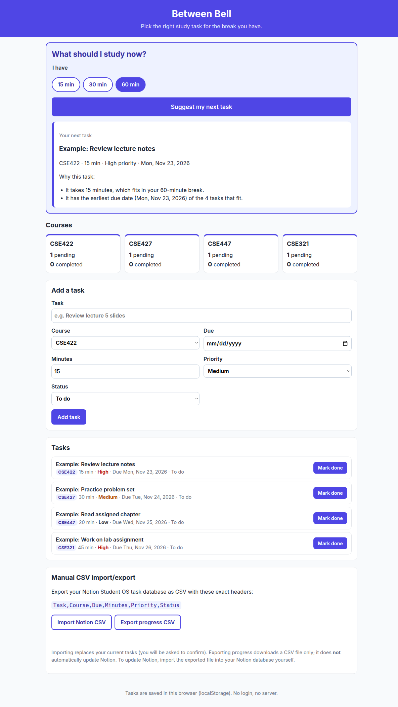

# Between Bell

A small study helper for the short breaks between classes. Tell it how much time you have (15, 30 or 60 minutes) and it recommends one study task that fits.



## Problem

Students often have 15–60 minute gaps between classes but lose time deciding what to study. Between Bell picks a task for the time you actually have, based on due dates and priority.

## Features

- **Course cards** for CSE422, CSE427, CSE447 and CSE321, showing pending and completed task counts.
- **Add tasks** with Task, Course, Due, Minutes, Priority (High / Medium / Low) and Status (To do / Done).
- **Mark tasks done** or **reopen** them.
- **Choose your available time**: 15, 30 or 60 minutes.
- **Suggest my next task**:
  - leaves out completed tasks and tasks longer than the selected time;
  - sorts by earliest due date, then by highest priority;
  - puts tasks with no due date last;
  - shows one suggestion and explains why it was picked;
  - shows a clear message when nothing fits (no pending tasks, or every pending task is too long).
- **Manual CSV import/export** (Notion Student OS): import a Notion CSV and export a progress CSV.
- **Persistence**: tasks are saved in your browser's `localStorage` and are still there after a refresh.
- **Demo data**: on first load the app adds four example tasks, one per course (15, 30, 20 and 45 minutes). Each is labeled “Example:” and is due in the next few days.

Plain HTML, CSS and JavaScript. No build step, backend, login, paid APIs or external runtime dependencies.

## Notion Student OS integration (Manual CSV import/export)

Between Bell works with a Notion Student OS task database through CSV files. It does not connect to the Notion API.

1. In your Notion task database, include these properties and export the view as CSV. Headers must match exactly:

   ```
   Task,Course,Due,Minutes,Priority,Status
   ```

2. In Between Bell, click **Import Notion CSV** and pick the file. The app asks you to confirm before it **replaces** your current tasks.
   - Quoted cells are supported (commas, quotes and line breaks inside cells).
   - Supported Due formats include `November 25, 2026`, `Nov 25, 2026`, `November 25, 2026 3:00 PM`, `11/25/2026`, `2026-11-25`, `2026/11/25`, `25 November 2026` and Notion date ranges (`Nov 25, 2026 → Nov 28, 2026`, where the start date is used). Slash dates are read as MM/DD/YYYY. Due can be empty.
   - Course must be one of CSE422, CSE427, CSE447 or CSE321. Minutes must be a positive whole number.
   - Priority must be High, Medium or Low (any case); empty means Medium. Status `Done`/`Complete`/`Completed` means Done; `To do`, `Not started`, `In progress` or empty mean To do.
   - Invalid rows are skipped, and the app tells you which rows and why.
3. Click **Export progress CSV** to download `between-bell-progress.csv` with the same headers and dates as `MM/DD/YYYY`.

> **Exporting progress does not automatically update Notion.** It only downloads a file. To update Notion, import or merge that CSV into your Notion database yourself.

`sample-tasks.csv` in this repository is a ready-to-import example with four tasks (one per course, 15/30/20/45 minutes) that also uses quoted cells and different date formats.

## How Devin Chat was used

The app was built with Devin from a single chat prompt describing the problem, features, CSV format and design. Devin:

- wrote `index.html`, `styles.css`, `app.js`, `sample-tasks.csv` and this README;
- ran a local static server and an automated browser script (Playwright driving Chrome) that checked task creation, recommendations (including ties, undated tasks and the “nothing fits” case), mark done/reopen, refresh persistence, CSV import (confirm/cancel, quoted cells, date formats, invalid rows, wrong headers), CSV export, and the mobile layout;
- committed the work and opened a pull request.

## Run locally

No install needed.

- **Quickest:** open `index.html` in a browser.
- **Local server (recommended):**

  ```bash
  python3 -m http.server 8000
  # then open http://localhost:8000/
  ```

## Manual testing checklist

1. Open the app. You should see four “Example:” tasks and each course card showing 1 pending / 0 completed.
2. Select **15 min** and click **Suggest my next task**. You should get the 15-minute CSE422 task with reasons.
3. Add a task (e.g. 10 min, earlier due date) and suggest again. The new task should be picked, and its course card count should go up.
4. Click **Mark done** on a task. The counts update and the task is no longer suggested. Click **Reopen** to undo.
5. Mark every task of 15 minutes or less as done and suggest with **15 min**. You should see “Nothing fits right now”.
6. Refresh the page. Your tasks and statuses are still there.
7. Click **Export progress CSV**. Open the file and check the headers and `MM/DD/YYYY` dates.
8. Click **Import Notion CSV** and choose `sample-tasks.csv`. Click Cancel first (nothing changes), then import again and click OK (the four sample tasks replace your list).

To reset to the demo data, clear this site's localStorage (DevTools → Application → Local Storage) and reload.

## Deploy on GitHub Pages

All paths are relative, so the app works from a project subpath.

1. Push the code to the `main` branch on GitHub.
2. Go to the repository's **Settings → Pages**.
3. Under **Build and deployment**, set **Source** to **Deploy from a branch**.
4. Choose branch **`main`** and folder **`/ (root)`**, then click **Save**.
5. After a minute or so the site will be live at `https://<your-username>.github.io/Between-Bell/`.
